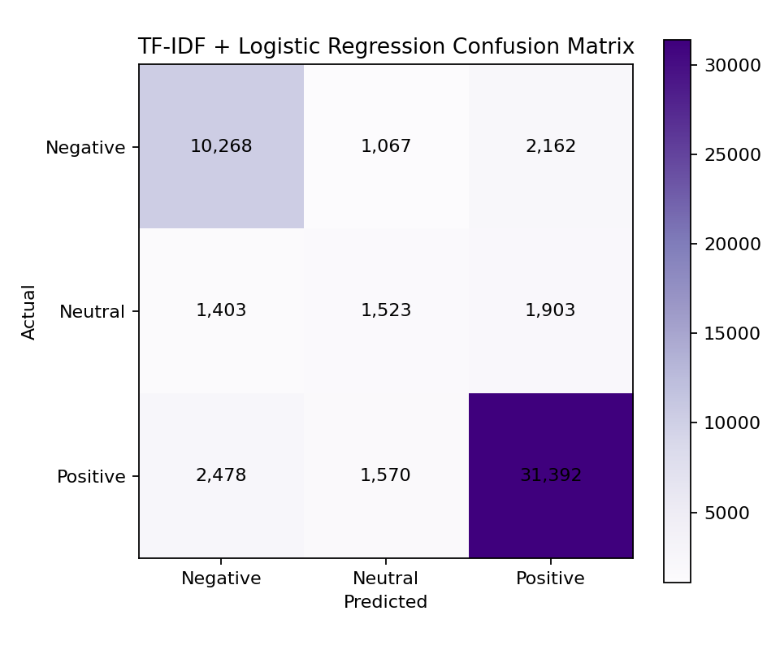

# Drug Review Sentiment Analysis

[](https://www.python.org/)
[](https://streamlit.io/)
[](LICENSE)

An academic NLP implementation developed into a reproducible portfolio project.
It classifies pharmaceutical reviews as **Negative**, **Neutral**, or **Positive**
and compares rule-based, classical machine-learning, and deep-learning methods.

> This research and educational demonstration is not a clinically validated
> healthcare system and must not be used for medical decisions.

## Objectives and approaches

The project investigates whether patient-written reviews can be classified from
their text using VADER, TF-IDF + Logistic Regression, LSTM, GRU, and
Bidirectional LSTM. The lightweight Logistic Regression pipeline is used for
production inference; neural models are kept as academic experiments.

```text
Raw review → validated preprocessing → TF-IDF features → Logistic Regression
                                                        ↓
                                  sentiment + probability distribution
```

## Dataset

The [UCI Drug Review Dataset (Drugs.com)](https://archive.ics.uci.edu/dataset/462/drug+review+dataset+drugs+com)
contains 215,063 reviews in predefined training (161,297) and test (53,766)
files. Ratings 1–4 map to Negative, 5–6 to Neutral, and 7–10 to Positive.
Dataset files are not committed; see [data/README.md](data/README.md).

## Verified original results

| Model | Accuracy | Weighted F1 |
|---|---:|---:|
| GRU | 77.97% | 79.91% |
| LSTM | 77.93% | 79.65% |
| TF-IDF + Logistic Regression | 74.71% | 76.90% |
| Bidirectional LSTM | 74.24% | 77.19% |
| VADER | 54.45% | 55.30% |

These are verified saved outputs from the original notebook, not newly invented
or silently recomputed values. See `results/model_comparison.csv`. Reproduced
production metrics are generated separately during training.

The refactored, negation-aware production pipeline was also executed on all
161,297 training rows and evaluated on the untouched 53,766-row test file:

| Reproduced metric | Result |
|---|---:|
| Accuracy | 80.32% |
| Macro-F1 | 65.57% |
| Weighted F1 | 80.06% |

This run used random seed 42 and completed training in 62.75 seconds on the
development machine. Its outputs are stored under `results/reproduced/`.

## Evaluation visualisation



An application screenshot can be added after deploying the Streamlit interface.

## Installation

Python 3.11 is recommended for macOS/Apple Silicon and Streamlit Cloud.

```bash
git clone https://github.com/nishan037/drug-review-sentiment-analysis.git
cd drug-review-sentiment-analysis
python3.11 -m venv .venv
source .venv/bin/activate
python -m pip install --upgrade pip
python -m pip install -r requirements-dev.txt
```

Copy the two CSV files into `data/`, then train without data leakage:

```bash
python -m src.train \
  --train-data data/drugsComTrain_raw.csv \
  --test-data data/drugsComTest_raw.csv
```

This writes the inference pipeline to `models/`, plus actual metrics,
predictions, configuration, classification report, and a confusion-matrix image
to `results/`.

## Run and test

```bash
pytest -q
streamlit run app/streamlit_app.py
```

To run the academic notebook:

```bash
jupyter lab notebooks/original_sentiment_analysis.ipynb
```

TensorFlow is intentionally excluded from the web-app requirements. Install
`requirements-deep-learning.txt` only when deliberately reproducing the neural
experiments. On an 8 GB M2 Mac, prefer the production model or reduced samples.

## Streamlit Community Cloud

1. Use the included, validated `models/tfidf_logistic_regression.joblib`, or
   regenerate it locally using the pinned versions.
2. Do not upload the raw dataset.
3. In Streamlit Community Cloud choose this repository, branch `main`, and entry
   point `app/streamlit_app.py`.
4. Select Python 3.11 if prompted. The app loads the model but never trains at startup.

If deployment reports “model unavailable,” verify its exact path and that Git
LFS/release downloads completed. Dependency errors should be reproduced locally
with a clean Python 3.11 environment and `requirements.txt`.

Because the Streamlit entry point is inside `app/`, `app/requirements.txt`
provides its lightweight inference dependencies directly to Community Cloud.
If Cloud reports a missing module, confirm this file exists on the deployed
branch, reboot the app, and inspect the dependency-install section of its logs.

## Repository layout

```text
app/        Streamlit interface
data/       dataset instructions (raw CSVs ignored)
docs/       detailed methodology
models/     generated inference artifacts
notebooks/  preserved original academic notebook
results/    verified historical and reproduced results
src/        reusable training, evaluation, preprocessing, and prediction code
tests/      automated unit and integration tests
```

## Limitations and future work

Ratings are proxy labels; class imbalance and mixed experiences make Neutral
especially difficult. The data may contain duplicates, condition-specific bias,
and outdated language. Future work could add grouped leakage checks, calibrated
probabilities, explainability, drift monitoring, transformer baselines, and
responsible subgroup analysis.

## Academic acknowledgement and author

Originally developed for the **MSc Artificial Intelligence Technologies and
Applications** programme at **MCAST, Malta**, then extended as a software
engineering and MLOps portfolio project.

**Nishan Jayathilake** · [GitHub: nishan037](https://github.com/nishan037)

Before publishing, confirm MCAST assessment rules and the UCI dataset terms.
The complete assignment PDF is intentionally excluded.

## GitHub publication commands

Run only after reviewing the files and creating an empty GitHub repository:

```bash
git init
git branch -M main
git add .
git status
git commit -m "Build reproducible drug review sentiment analysis project"
git remote add origin https://github.com/nishan037/drug-review-sentiment-analysis.git
git push -u origin main
```

The final `git push` requires explicit approval and is not performed automatically.
